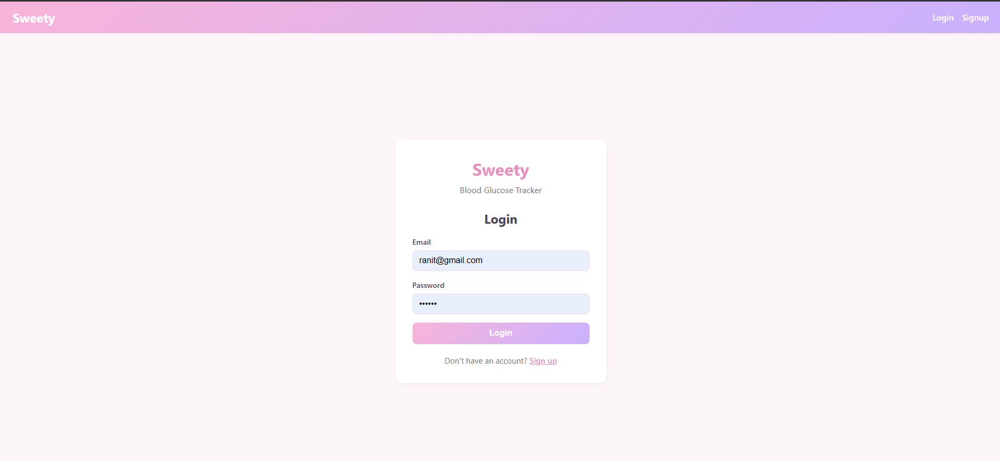
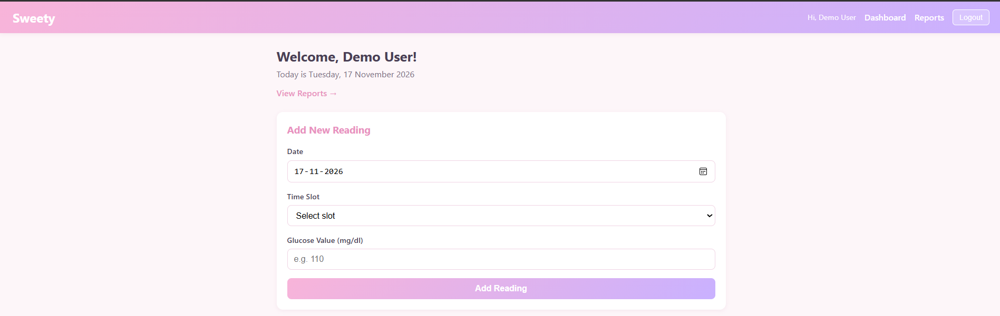
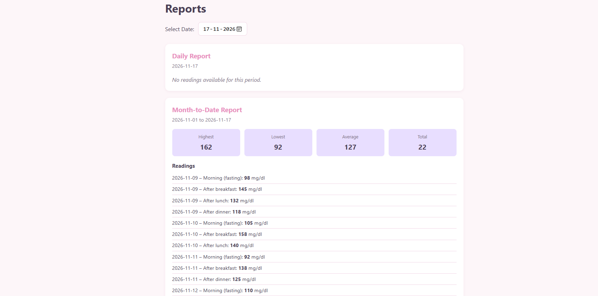
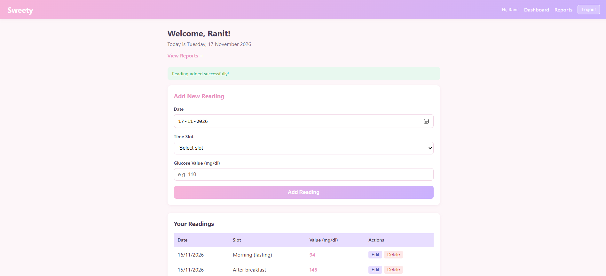
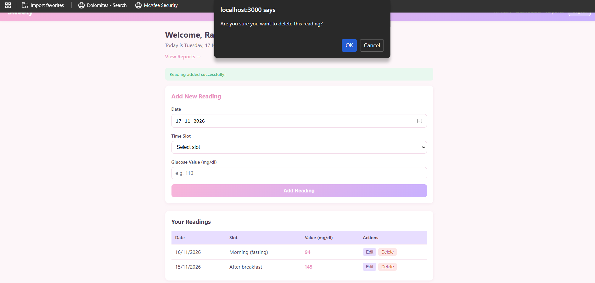
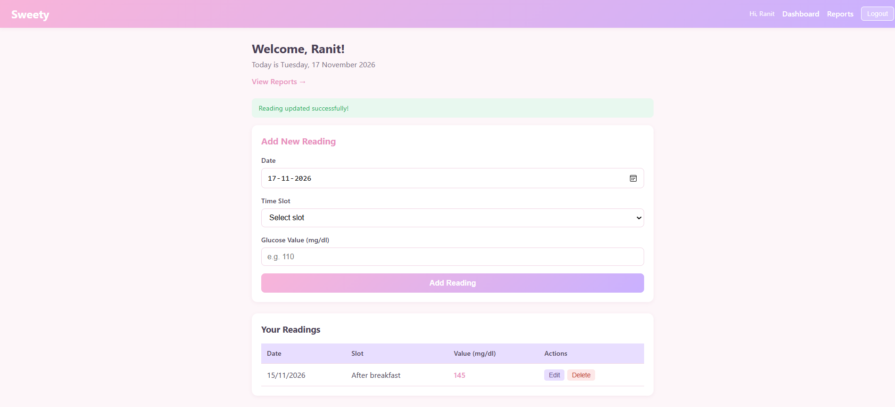
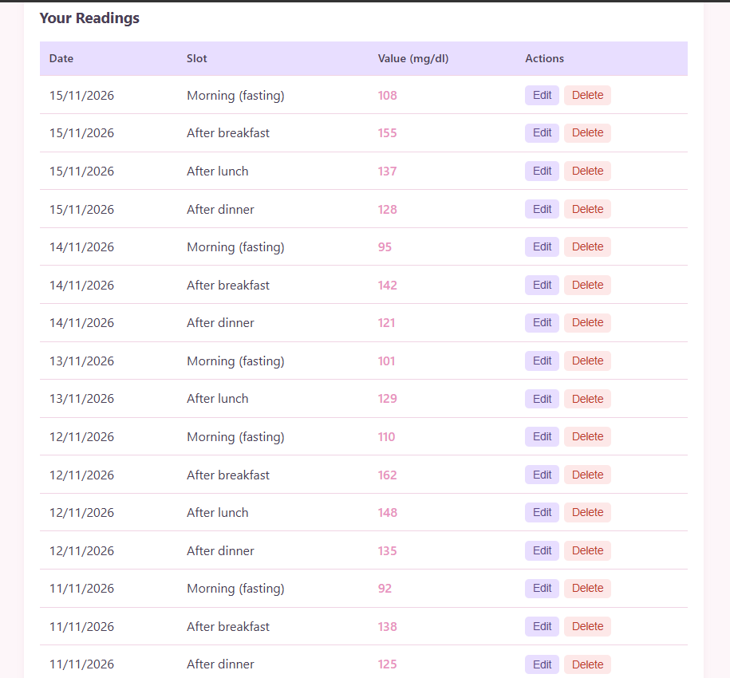

# Sweety – Blood Glucose Tracker

A simple full-stack web application for tracking blood glucose readings.  
Built with React, Node.js, Express and PostgreSQL in a beginner-friendly style.

## Features

- User signup and login with JWT authentication
- Add, view, edit and delete blood glucose readings
- Four fixed time slots: Morning (fasting), After breakfast, After lunch, After dinner
- Validation: value 40–600, no future dates, max 4 readings per day, one reading per slot per day
- Daily, Month-to-Date and previous Monthly reports (highest, lowest, average, total)
- Soft pink / white / light-purple UI

## Technologies Used

**Frontend**
- React.js
- JavaScript
- React Router
- Axios
- Plain CSS

**Backend**
- Node.js
- Express.js
- PostgreSQL
- bcryptjs (password hashing)
- jsonwebtoken (JWT)
- dotenv

## Folder Structure

```
sweety/
├── backend/
│   ├── config/
│   │   └── db.js
│   ├── controllers/
│   │   ├── authController.js
│   │   ├── readingController.js
│   │   └── reportController.js
│   ├── middleware/
│   │   └── authMiddleware.js
│   ├── routes/
│   │   ├── authRoutes.js
│   │   ├── readingRoutes.js
│   │   └── reportRoutes.js
│   ├── tests/
│   ├── .env.example
│   ├── package.json
|   ├── seed.js
│   └── server.js
├── frontend/
│   ├── public/
│   │   └── index.html
│   ├── src/
│   │   ├── components/
│   │   │   ├── Navbar.js
│   │   │   ├── ReadingForm.js
│   │   │   ├── ReadingList.js
│   │   │   └── ReportCard.js
│   │   ├── pages/
│   │   │   ├── Login.js
│   │   │   ├── Signup.js
│   │   │   ├── Dashboard.js
│   │   │   └── Reports.js
│   │   ├── services/
│   │   │   └── api.js
│   │   ├── App.js
│   │   ├── App.css
│   │   └── index.js
│   └── package.json
├── database/
│   └── schema.sql
├── screenshots
└── README.md
```

## PostgreSQL Database Setup

1. Make sure PostgreSQL is installed and running.
2. Create a user and database (you can change names/passwords):

```bash
sudo -u postgres psql
```

```sql
CREATE USER sweety WITH PASSWORD 'sweety123';
CREATE DATABASE sweety OWNER sweety;
GRANT ALL PRIVILEGES ON DATABASE sweety TO sweety;
\c sweety
GRANT ALL ON SCHEMA public TO sweety;
\q
```

3. Run the schema:

```bash
psql -U sweety -d sweety -f database/schema.sql
```

(Enter the password when prompted.)

## Environment Variables

Copy the example file and edit it:

```bash
cd backend
cp .env.example .env
```

Example `.env`:

```
PORT=5000
DB_HOST=localhost
DB_PORT=5432
DB_NAME=sweety
DB_USER=sweety
DB_PASSWORD=sweety123
JWT_SECRET=your_super_secret_jwt_key_change_this
```

## Backend Installation & Running

```bash
cd backend
npm install
# or: yarn install
npm start
```

Server runs on http://localhost:5000

## Frontend Installation & Running

```bash
cd frontend
npm install
npm start
```

Frontend runs on http://localhost:3000  
It talks to the backend at http://localhost:5000/api by default.

You can change the API URL with:

```bash
REACT_APP_API_URL=http://localhost:5000/api npm start
```

## API Endpoints

### Auth (public)
| Method | Endpoint             Description      
|--------|---------------------------------------
| POST   | /api/auth/signup     Create account   
| POST   | /api/auth/login      Login & get token

### Readings (protected – need Bearer token)
 Method  Endpoint             Description          
---------------------------------------------------
 POST    /api/readings        Add reading          
 GET     /api/readings        Get all my readings  
 GET     /api/readings/:id    Get one reading      
 PUT     /api/readings/:id    Update reading       
 DELETE  /api/readings/:id    Delete reading       

### Reports (protected)
| Method  Endpoint                               Description                
|--------|---------------------------------------|----------------------------|
| GET     /api/reports/daily?date=YYYY-MM-DD     Daily report               
| GET     /api/reports/month-to-date?date=...    Month-to-date report       
| GET     /api/reports/monthly?date=YYYY-MM-DD   Previous full month report 

## Testing

Backend has a few simple beginner-friendly tests:

```bash
cd backend
npm test
```

These check basic validation logic (glucose range, future date, etc.).

## Seed Demo Data
run the following command inside the backend folder:
cd backend
npm run seed

Demo Login
Email: demo@sweety.com
Password: Sweety@123


## Assumptions Made During Development

- Users are responsible for entering correct dates and values.
- Timezone is handled by the browser / PostgreSQL default (UTC-friendly dates).
- JWT expires after 7 days.
- Password minimum length is 6 characters.
- bcryptjs is used instead of bcrypt for easier installation.

## How to Run the Complete Project from Scratch

1. Install Node.js and PostgreSQL.
2. Create the database and run `database/schema.sql`.
3. Set up `backend/.env`.
4. In `backend/`: `npm install` then `npm start`.
5. In `frontend/`: `npm install` then `npm start`.
6. Open http://localhost:3000 in the browser.
7. Sign up, add some readings, and check the Reports page.

## Screenshorts

### Login Page
- 
### 2. Signup Page


### 3. Dashboard


### 4. Reports


### 5. Adding 


### 6. Deleting


### 7. Update


### 8. Reading



### Assumptions
- All glucose readings are stored in mg/dL.
- Each user can access only their own glucose readings.
- A maximum of four readings can be added per day.
- Each reading is associated with a date and time slot.

### Future Improvements
- Add charts to visualize blood glucose trends.
- Add password reset functionality.
- Improve mobile responsiveness.
- Add more frontend and backend tests.
- Add reminders for recording glucose readings.


